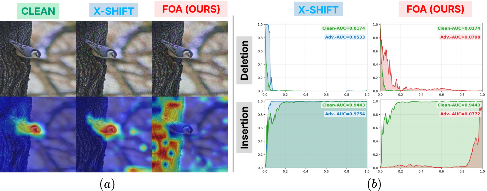
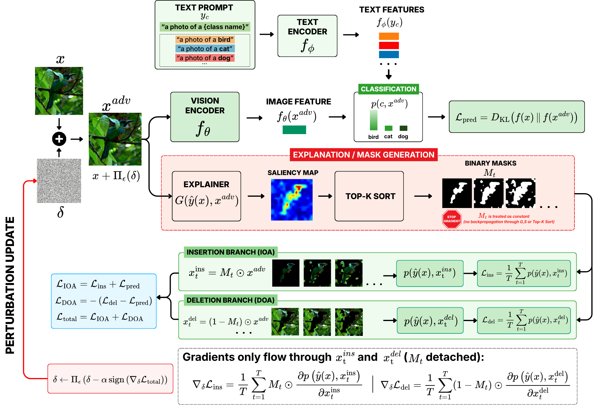

# Faithfulness Oriented Adversarial (FOA) Attack to VLMs

Script-first runbook for adversarial explanation robustness experiments.







## 1) Key files and locations
- Main attack/evaluation entrypoint: ./adv_score.py
- FOA implementation file: ./RISE/evaluation.py
- Core class: JointAdversarialCausalMetric
- Core method: JointAdversarialCausalMetric.single_run(...)


## 2) Run attack scripts (IOA, DOA, FOA)

Mode mapping:

- del -> DOA
- ins -> IOA
- del+ins -> FOA

### 2.1 Single explainer

```powershell
python .\adv_score.py \
  --clip-model ViT-B/16 \
  --clip-checkpoint .\checkpoints\ViT-B-16.pt \
  --hm-type eclip \
  --mode del+ins \
  --img-dir .\images\imagenet-val \
  --sample-path .\classification_reuslt\imagenet\vit_b_16_1k.json \
  --output-dir .\outputs\result_16\ImageNet\CLIP_ViTB16\ins_del_optimized_output \
  --eps 16 \
  --alpha 4 \
  --pgd-steps 50 \
  --process-batch-size 100
```

### 2.2 Multiple explainers

```powershell
foreach ($hm in @("eclip","game","gradcam","maskclip","rise")) {
  python .\adv_score.py \
    --clip-model ViT-B/16 \
    --clip-checkpoint .\checkpoints\ViT-B-16.pt \
    --hm-type $hm \
    --mode del+ins \
    --img-dir .\images\imagenet-val \
    --sample-path .\classification_reuslt\imagenet\vit_b_16_1k.json \
    --output-dir .\outputs\result_16\ImageNet\CLIP_ViTB16\ins_del_optimized_output \
    --eps 16 --alpha 4 --pgd-steps 50 --process-batch-size 100
}
```

## 3) Run ROAD evaluation

All CLIP/BLIP/SigLIP deletion evaluators now run two distinct metrics:

- **ROAD** (`metric: road_deletion`): noisy linear imputation (Remove And Debias).
  No additional pretrained imputation checkpoint is needed.
- **DEL_avg_channel**: replace deleted pixels with the original image's mean
  value per channel. This is a deletion baseline, **not ROAD**.

Both use the same image, saliency, scoring label, nested pixel masks and
percentages (default 0.1..0.9). The shared seed controls attribution tie-breaking
and linear noise without changing caller RNG states. Each percentage starts
from the untouched image. AUC is integrated over the supplied percentages;
fair AUC divides the curve by its own maximum.

Each sample receives `road_deletion_information.json` and
`del_avg_channel_information.json`, with separate curves, AUCs, imputer
metadata and seeds. Existing CLIP results without this metadata are recomputed
instead of merging new metadata into old curves. BLIP resumes only when both
outputs are present; use `--overwrite` if recorded evaluation settings differ.
Existing LaTeX exporters are unchanged and continue reading only true ROAD.

```bash
python road_score_CLIP.py --input-root outputs_fixed --clip-model ViT-B/16 --device cuda --seed 42
python road_score_BLIP.py --input-root BLIP_result --epsilon 2 --device cuda --seed 42
python road_score_SIGLIP.py --input-root SIGLIP_result --device cuda --seed 42
```

The CLIP entrypoint also supports the batch options of
`main_script/ROAD_evaluate_and_export.py` shown below. BLIP and SigLIP read
the saved attack `run_config.json` to reproduce their classifiers and use
post-attack saliency. SigLIP accepts any root containing its run configs,
including an epsilon-specific subtree. Run each family in its compatible
Python environment.

`clean_score.py` and `clean_score_BLIP.py` also save both clean baselines.
CLIP's `--road-imputer` and batch `--imputer` remain accepted, but `linear`
and `fixed` now both run the pair; `zero` additionally saves **DEL_zero** to
`del_zero_information.json`, never under the ROAD filename. Use
`--road-seed` for CLIP clean runs, `--seed` for evaluation runners.
Linear ROAD requires at least one retained pixel, so percentages must be
strictly increasing, have at least two values, and stay in `[0, 1)`.

### Fixed-mask CLIP attacks

`adv_score_CLIP_fixed_masked.py` uses `AdversarialCausalMetricFixedMask` for
`del`/`ins` and `JointAdversarialCausalMetricFixedMask` for `del+ins`.
`--mask-source clean` computes saliency once on the clean image.
`--mask-source random --seed 7` samples a random pixel permutation once with a
local RNG. The same cumulative masks are reused throughout PGD; image and
substrate values still come from the current adversarial image. Joint attacks
share the same ranking for deletion and insertion.

After optimization, saliency is recomputed on the adversarial image and the
usual deletion/insertion evaluation runs on that **new map**, not the fixed
attack masks. Existing dynamic-mask runners are unchanged. Fixed-mask attacks
currently require RGB inputs with 224 * 224 pixels, as do the existing metrics.

```bash
python adv_score_CLIP_fixed_masked.py --mask-source clean --mode del+ins --img-dir images --sample-path samples.json --output-dir outputs_fixed
python adv_score_CLIP_fixed_masked.py --mask-source random --seed 7 --mode del --img-dir images --sample-path samples.json --output-dir outputs_fixed
python run_different_masking_strategies_CLIP.py --mask-sources clean random --seeds 7 42 --mode del+ins --img-dir images --sample-path samples.json --output-dir outputs_fixed
bash script_sh/adv_score_CLIP_fixed_masked.sh --mask-source random --seed 7 --img-dir images --sample-path samples.json
bash script_sh/run_clip_fixed_masked_ins.sh --mask-source clean --img-dir images --sample-path samples.json
bash script_sh/run_clip_fixed_masked_del.sh --mask-source random --seed 7 --img-dir images --sample-path samples.json
bash script_sh/run_clip_fixed_masked_joint.sh --mask-source clean --img-dir images --sample-path samples.json
```

The multi-strategy runner forwards other CLI options to the fixed-mask runner
and starts an isolated process for each strategy/seed. Output is separated as
`<output-dir>/<clean|random_seed_N>/<hm-type>/<mode>/<sample>/`.
Each sample includes `fixed_salient_order.npy`, the adversarial image,
fresh adversarial saliency outputs, summaries, and `curve_information.json`
with `mask_source`, `seed`, `evaluation_map_source`, loss traces and AUCs.
The shell launcher also supports `PYTHON`, `MASK_SOURCE`, `SEED`, and `MODE`
environment variables; explicit CLI arguments override its defaults.
The three `run_clip_fixed_masked_{ins,del,joint}.sh` launchers reuse this shell
launcher and pin their respective modes (`ins`, `del`, `del+ins`), regardless
of `MODE` or a forwarded `--mode`. Other options, including mask source,
seed, input paths and output directory, are forwarded unchanged.

```powershell
python .\main_script\ROAD_evaluate_and_export.py \
  --root-dir .\outputs\result_16 \
  --clip-checkpoint .\checkpoints\ViT-B-16.pt \
  --output-root .\outputs\ROAD\eps_16 \
  --datasets ImageNet CUB StandfordPet \
  --explainers eclip game gradcam maskclip rise \
  --approaches ins_del_optimized_output \
  --model-subdir CLIP_ViTB16
```

Note: this script currently expects the dataset token StandfordPet.

### Generate a classification label index

For a dataset with immediate class subfolders such as
`StandfordPet_Dataset/n02090379-redbone`, run:

```bash
python generate_label_index.py --data-path /datastore/khangtd/Adversarial-Robustness-Grad-Eclip/StandfordPet_Dataset --output standfordpet_label.json
```

The script sorts class folders by name and assigns consecutive labels starting
at zero. It preserves folder names as JSON keys, removes an `n<digits>-` prefix
from class names, and converts underscores and hyphens to spaces. Hidden folders
and root-level files are ignored. The input must be the class-folder root, not
its parent or an individual class folder.

Use the resulting mapping with classification:

```bash
python classify.py --data-path /datastore/khangtd/Adversarial-Robustness-Grad-Eclip/StandfordPet_Dataset --index-json standfordpet_label.json --output pet_classification.json
```

Class names are read from this mapping; `--classnames-path` is not needed.
If supplying a separate class-name list later, keep its order consistent with
these generated labels.

For CUB folders such as `001.Black_footed_Albatross`, override the prefix-removal
regex to remove everything through the first dot:

```bash
python generate_label_index.py --data-path CUB_200_2011/images --output cub_label.json --strip-prefix-pattern '^[^.]*\.'
```

This produces `"001.Black_footed_Albatross": [0, "Black footed Albatross"]`.
Only the class name is transformed; JSON keys and sorted label order are
unchanged. Without this option, the default remains `^n\d+-`, so CUB numeric
prefixes are preserved. Folder names that do not match the pattern are kept
before underscores and hyphens are converted to spaces. Invalid regexes or
patterns that leave an empty class name raise an error.

## 4 Quick FOA run

```powershell
python .\adv_score.py \
  --clip-model ViT-B/16 \
  --clip-checkpoint .\checkpoints\ViT-B-16.pt \
  --hm-type eclip \
  --mode del+ins \
  --img-dir .\images\imagenet-val \
  --sample-path .\classification_reuslt\imagenet\vit_b_16_1k.json \
  --output-dir .\outputs\result_16\ImageNet\CLIP_ViTB16\ins_del_optimized_output \
  --eps 16 --alpha 4 --pgd-steps 50 --process-batch-size 64
```
