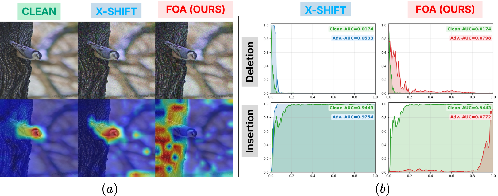
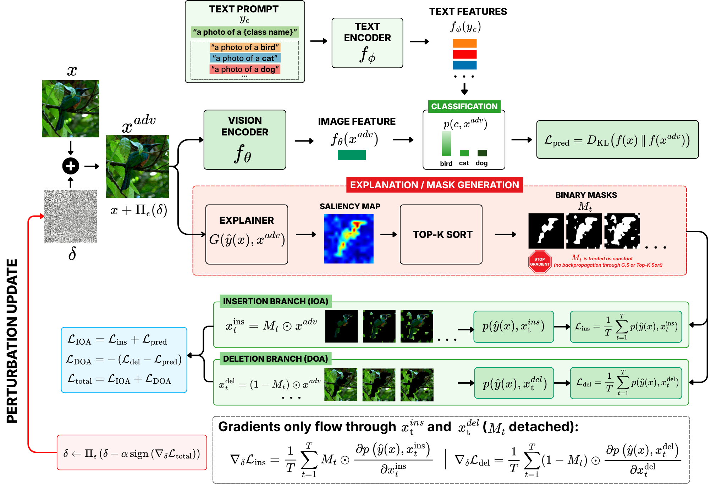

# Faithfulness Oriented Adversarial (FOA) Attack to VLMs

Script-first runbook for adversarial explanation robustness experiments.







## 1) Key files and locations
- Main attack/evaluation entrypoint: ./adv_score.py
- FOA implementation file: ./RISE/evaluation.py
- Core class: JointAdversarialCausalMetric
- Core method: JointAdversarialCausalMetric.single_run(...)


## 2) Run attack scripts (IOA, DOA, FOA)

Mode mapping:

- del -> DOA
- ins -> IOA
- del+ins -> FOA

### 2.1 Single explainer

```powershell
python .\adv_score.py \
  --clip-model ViT-B/16 \
  --clip-checkpoint .\checkpoints\ViT-B-16.pt \
  --hm-type eclip \
  --mode del+ins \
  --img-dir .\images\imagenet-val \
  --sample-path .\classification_reuslt\imagenet\vit_b_16_1k.json \
  --output-dir .\outputs\result_16\ImageNet\CLIP_ViTB16\ins_del_optimized_output \
  --eps 16 \
  --alpha 4 \
  --pgd-steps 50 \
  --process-batch-size 100
```

### 2.2 Multiple explainers

```powershell
foreach ($hm in @("eclip","game","gradcam","maskclip","rise")) {
  python .\adv_score.py \
    --clip-model ViT-B/16 \
    --clip-checkpoint .\checkpoints\ViT-B-16.pt \
    --hm-type $hm \
    --mode del+ins \
    --img-dir .\images\imagenet-val \
    --sample-path .\classification_reuslt\imagenet\vit_b_16_1k.json \
    --output-dir .\outputs\result_16\ImageNet\CLIP_ViTB16\ins_del_optimized_output \
    --eps 16 --alpha 4 --pgd-steps 50 --process-batch-size 100
}
```

## 3) Run ROAD evaluation

```powershell
python .\main_script\ROAD_evaluate_and_export.py \
  --root-dir .\outputs\result_16 \
  --clip-checkpoint .\checkpoints\ViT-B-16.pt \
  --output-root .\outputs\ROAD\eps_16 \
  --datasets ImageNet CUB StandfordPet \
  --explainers eclip game gradcam maskclip rise \
  --approaches ins_del_optimized_output \
  --model-subdir CLIP_ViTB16
```

Note: this script currently expects the dataset token StandfordPet.

### Generate a classification label index

For a dataset with immediate class subfolders such as
`StandfordPet_Dataset/n02090379-redbone`, run:

```bash
python generate_label_index.py --data-path /datastore/khangtd/Adversarial-Robustness-Grad-Eclip/StandfordPet_Dataset --output standfordpet_label.json
```

The script sorts class folders by name and assigns consecutive labels starting
at zero. It preserves folder names as JSON keys, removes an `n<digits>-` prefix
from class names, and converts underscores and hyphens to spaces. Hidden folders
and root-level files are ignored. The input must be the class-folder root, not
its parent or an individual class folder.

Use the resulting mapping with classification:

```bash
python classify.py --data-path /datastore/khangtd/Adversarial-Robustness-Grad-Eclip/StandfordPet_Dataset --index-json standfordpet_label.json --output pet_classification.json
```

Class names are read from this mapping; `--classnames-path` is not needed.
If supplying a separate class-name list later, keep its order consistent with
these generated labels.

For CUB folders such as `001.Black_footed_Albatross`, override the prefix-removal
regex to remove everything through the first dot:

```bash
python generate_label_index.py --data-path CUB_200_2011/images --output cub_label.json --strip-prefix-pattern '^[^.]*\.'
```

This produces `"001.Black_footed_Albatross": [0, "Black footed Albatross"]`.
Only the class name is transformed; JSON keys and sorted label order are
unchanged. Without this option, the default remains `^n\d+-`, so CUB numeric
prefixes are preserved. Folder names that do not match the pattern are kept
before underscores and hyphens are converted to spaces. Invalid regexes or
patterns that leave an empty class name raise an error.

## 4 Quick FOA run

```powershell
python .\adv_score.py \
  --clip-model ViT-B/16 \
  --clip-checkpoint .\checkpoints\ViT-B-16.pt \
  --hm-type eclip \
  --mode del+ins \
  --img-dir .\images\imagenet-val \
  --sample-path .\classification_reuslt\imagenet\vit_b_16_1k.json \
  --output-dir .\outputs\result_16\ImageNet\CLIP_ViTB16\ins_del_optimized_output \
  --eps 16 --alpha 4 --pgd-steps 50 --process-batch-size 64
```
